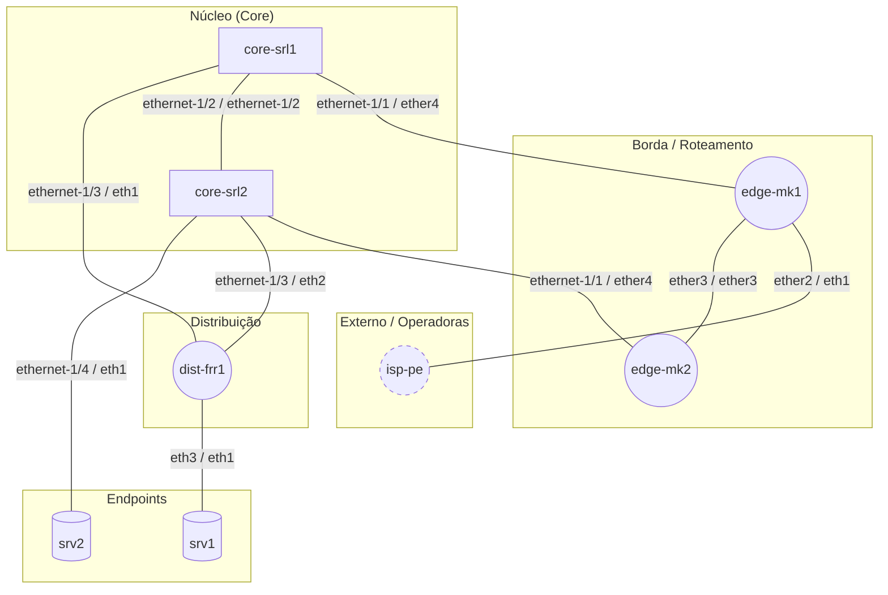

# Laboratório Containerlab

Documentação gerada automaticamente pelo **Mapa de Rede 0.2.0** em 25/10/2026 13:41 a partir de `172.20.20.11`.

## Resumo

| Indicador | Valor |
|---|---|
| Equipamentos coletados | 7 |
| Vistos apenas por vizinhos | 1 |
| Links físicos | 9 |
| Links L3 inferidos | 0 |
| Adjacências de roteamento | 0 |
| Interfaces | 148 |
| Alvos com falha | 3 |
| Duração (s) | 34.8 |
| Fabricantes | Linux (4), Nokia (2), MikroTik (2) |

## Diagrama

## Inventário

| Hostname | IP | Papel | Camada | Fabricante | Modelo | Versão | Serial |
|---|---|---|---|---|---|---|---|
| [edge-mk1](devices/edge-mk1.md) | 172.20.20.11 | Roteador | Borda / Roteamento | MikroTik | CHR QEMU Standard PC (i440FX + PIIX, 1996) | 7.16.2 (stable) | H1GQLYHA4RK |
| [edge-mk2](devices/edge-mk2.md) | 172.20.20.12 | Roteador | Borda / Roteamento | MikroTik | CHR QEMU Standard PC (i440FX + PIIX, 1996) | 7.16.2 (stable) | UU4824GFMxE |
| [core-srl1](devices/core-srl1.md) | 172.20.20.21 | Switch L3 | Núcleo (Core) | Nokia | 7220 IXR-D2L | v25.10.5-111-g6fbddec84ef | Sim Serial No. |
| [core-srl2](devices/core-srl2.md) | 172.20.20.22 | Switch L3 | Núcleo (Core) | Nokia | 7220 IXR-D2L | v25.10.5-111-g6fbddec84ef | Sim Serial No. |
| [dist-frr1](devices/dist-frr1.md) | 172.20.20.31 | Roteador | Distribuição | Linux | Virtual Machine | 6.17.0-1022-azure |  |
| [srv1](devices/srv1.md) | 172.20.20.41 | Servidor/Host | Endpoints | Linux | Virtual Machine | 6.17.0-1022-azure |  |
| [srv2](devices/srv2.md) | 172.20.20.42 | Servidor/Host | Endpoints | Linux | Virtual Machine | 6.17.0-1022-azure |  |
| isp-pe _(não coletado)_ | 172.20.20.2 | Roteador | Externo / Operadoras | Linux |  |  |  |

## Links

| ID | Origem | Interface | Destino | Interface | Tipo | Protocolos | Sub-rede |
|---|---|---|---|---|---|---|---|
| L1 | core-srl1 | ethernet-1/1 | edge-mk1 | ether4 | physical | lldp | 10.10.1.0/30 |
| L2 | core-srl1 | ethernet-1/2 | core-srl2 | ethernet-1/2 | physical | lldp | 10.10.0.0/31 |
| L3 | core-srl1 | ethernet-1/3 | dist-frr1 | eth1 | physical | lldp | 10.10.3.0/30 |
| L4 | core-srl2 | ethernet-1/1 | edge-mk2 | ether4 | physical | lldp | 10.10.2.0/30 |
| L5 | core-srl2 | ethernet-1/3 | dist-frr1 | eth2 | physical | lldp | 10.10.4.0/30 |
| L6 | core-srl2 | ethernet-1/4 | srv2 | eth1 | physical | lldp | 192.168.20.0/24 |
| L7 | dist-frr1 | eth3 | srv1 | eth1 | physical | lldp | 192.168.10.0/24 |
| L8 | edge-mk1 | ether2 | isp-pe | eth1 | physical | bgp, lldp | 200.200.10.0/30 |
| L9 | edge-mk1 | ether3 | edge-mk2 | ether3 | physical | lldp, ospf | 10.255.0.0/30 |

## Falhas de coleta

| Alvo | Motivo |
|---|---|
| 10.255.0.2 | IP anunciado 10.255.0.2: snmp: sem resposta para 2 credencial(is) (community/usuário incorreto, ACL ou agente desligado); sem resposta: portas 22/80/443/830 fechadas e SNMP sem resposta \| nenhum outro IP de gerência conhecido (configure DNS, memória/inventário ou varredura) |
| 172.20.20.1 | varredura 172.20.20.1: snmp: sem resposta para 2 credencial(is) (community/usuário incorreto, ACL ou agente desligado); ssh: autenticação recusada para 3 credencial(is); ssh: fabricante não identificado |
| 172.20.20.2 | varredura 172.20.20.2: snmp: sem resposta para 2 credencial(is) (community/usuário incorreto, ACL ou agente desligado); ssh: autenticação recusada para 3 credencial(is); ssh: fabricante não identificado |
